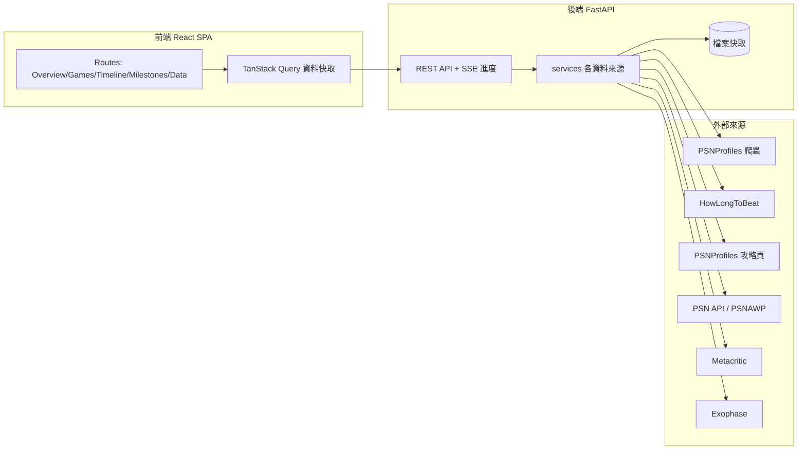

# Trophy Hunter Dashboard — 現代化重寫 + 資料整合 設計文件

- **日期**：2026-07-23
- **狀態**：待使用者確認 (Draft)
- **作者**：使用者 + Claude

---

## 1. 背景與目標

現有專案是一個 Streamlit app（[app.py](../../../app.py)、[components/](../../../components)、[core/](../../../core)），透過爬蟲抓取 [PSNProfiles](https://psnprofiles.com/) 的公開獎盃資料，用左側 sidebar 輸入使用者名稱、上方 5 個分頁呈現圖表。

使用者的需求：

1. **視覺重做**——不要左側 sidebar + 分頁的格式，改成現代、好看的介面。
2. **加入「遊玩時數」數字**——類似 HowLongToBeat 的通關時數、PSNProfiles 白金攻略的預估時數、以及使用者自己在 PSN 上的真實遊玩時數。
3. **整合外部網站連結**——每款遊戲一鍵跳到 PSNProfiles、PSNine、HowLongToBeat、Metacritic、Exophase 等，方便查攻略／資訊。

### 目標 (Goals)

- 全新的現代化前端，視覺精緻、好維護、好擴充。
- 每款遊戲整合多來源時數與評分，並提供外部連結。
- 沿用現有可運作的 Python 爬蟲邏輯，降低重寫風險。
- 本機優先，但架構保持乾淨、日後可部署。

### 非目標 (Non-Goals)

- 不做多人帳號系統 / 公開上線的登入機制（本機個人使用；架構保留可部署，但多租戶不在此次範圍）。
- 不做原生 App。
- 不保證每個外部來源對每款遊戲都有資料（best-effort，缺資料時優雅降級）。

---

## 2. 關鍵決策（已與使用者確認）

| 項目 | 決策 |
|------|------|
| 前端 | React SPA — Vite + React + TypeScript + Tailwind CSS + shadcn/ui + Recharts |
| 後端 | FastAPI (Python)，沿用現有 PSNProfiles 爬蟲邏輯 |
| 版面 | **方案 A**：頂部導覽列 + 多頁（Overview / Games / Timeline / Milestones / Data） |
| 配色 | **Trophy Gold**：暖炭黑底 (charcoal) + 琥珀金主色 (amber/gold)，深色主題 |
| 使用情境 | 本機為主，程式寫成可部署的乾淨結構 |
| 時數/資料來源 | HowLongToBeat、PSNProfiles 白金攻略、PSN 真實遊玩時數、Metacritic 評分（全選） |
| 外部連結 | PSNProfiles、PSNine、HowLongToBeat、Metacritic、Exophase |
| PSN token | NPSSO 放後端 `.env`（`PSN_NPSSO=...`），已加入 `.gitignore` |

### 重要限制：PSN 真實時數只限本人帳號

PSN 的「真實遊玩時數」因隱私限制，**只能取得 NPSSO token 所屬帳號本人**的資料。因此設計上：

- 查詢**本人**的 PSN ID（等同 token 擁有者）→ 疊加顯示真實遊玩時數。
- 查詢**其他人**的公開 ID → 只顯示公開／估計資料（HLTB 估時、白金攻略估時、Metacritic 評分、Exophase）。
- 後端提供 `GET /api/me`，回報 token 是否設定、以及 token 擁有者的 online id，供前端判斷是否為「本人檔案」。

---

## 3. 架構總覽



前後端分離：前端是純 UI（呼叫後端 API），後端封裝所有爬蟲/API/快取邏輯。本機同時跑 backend（如 `:8000`）與 frontend dev server（如 `:5173`），前端以 proxy 或 `VITE_API_BASE` 指向後端。

---

## 4. 後端設計 (FastAPI)

### 4.1 模組結構

```
backend/
  app/
    main.py              # FastAPI app、CORS、router 掛載
    config.py            # 讀 .env（PSN_NPSSO、快取路徑、CORS origins）
    models.py            # Pydantic models（Trophy, GameSummary, ProfileSummary, Enrichment...）
    api/
      profile.py         # /api/profile/*
      games.py           # /api/profile/{username}/games
      meta.py            # /api/me、/api/health
    services/
      psnprofiles.py     # 沿用現有 parse_profile_summary / parse_trophy_log_page / 爬蟲
      hltb.py            # HowLongToBeat 查詢
      guide.py           # PSNProfiles 攻略：預估白金時數、難度、攻略連結
      psn_playtime.py    # PSNAWP：本人真實遊玩時數
      metacritic.py      # Metacritic 評分
      exophase.py        # Exophase best-effort 統計 + 連結
      links.py           # 依遊戲名產生各外部網站 URL
      matching.py        # 遊戲名正規化 + 跨來源模糊比對
    core/
      cache.py           # 沿用/擴充現有檔案快取（多種 TTL）
      http.py            # 共用 cloudscraper/requests session、禮貌延遲、重試
  tests/
  requirements.txt
```

### 4.2 API 端點

| Method | Path | 說明 |
|--------|------|------|
| GET | `/api/health` | 健康檢查 |
| GET | `/api/me` | token 是否設定、token 擁有者 online id |
| GET | `/api/profile/{username}` | 個人摘要 + 完整獎盃 log（快取優先） |
| GET | `/api/profile/{username}/stream` | SSE：回報爬蟲進度（頁數/總頁數），供前端顯示進度條 |
| GET | `/api/profile/{username}/games` | 以遊戲聚合的視圖：每款遊戲的獎盃統計 + enrichment（HLTB/攻略/Metacritic/連結，若為本人再加真實時數） |
| POST | `/api/profile/{username}/refresh` | 強制略過快取重新抓取 |

- 進度機制採 **SSE**（Server-Sent Events）取代 Streamlit 原本的 progress_bar；前端訂閱 stream 顯示「Scraping page X of ~Y」。
- `/games` 的 enrichment 為 best-effort：任一來源失敗回 `null` 欄位，不影響整體回應。

### 4.3 資料模型（重點欄位）

- `Trophy`：game, title, grade, rarity_percent, timestamp, icon_url（沿用現有欄位）。
- `GameSummary`：name, trophy_counts{bronze/silver/gold/platinum}, earned_vs_total, completion%, first/last earned, icon。
- `Enrichment`：
  - `hltb`：main, main_extra, completionist（小時）
  - `guide`：platinum_hours_low/high, difficulty(1-10), playthroughs, guide_url
  - `metacritic`：metascore, userscore, url
  - `psn_playtime`：play_duration_hours, play_count, first_played, last_played（僅本人）
  - `links`：{psnprofiles, psnine, hltb, metacritic, exophase}
  - `match_confidence`：跨來源比對信心（見 §5）

### 4.4 快取策略（擴充 core/cache.py）

不同資料變動頻率不同，採分層 TTL：

| 資料 | TTL | 理由 |
|------|-----|------|
| Profile summary + trophy log | 24h（沿用現有） | 個人資料常更新 |
| HLTB / 攻略 / Metacritic（依遊戲） | 14–30 天 | 幾乎不變，且可跨使用者共用 |
| Exophase | 14–30 天 | 同上 |
| PSN 真實時數 | 6–12h | 個人遊玩會變動 |
| 遊戲名比對結果 | 長期（可手動清） | 比對成本高，結果穩定 |

快取以檔案為主（沿用現有 JSON 檔做法），key 對遊戲類用正規化名稱、對個人類用 username。

---

## 5. 資料來源與遊戲比對

### 5.1 各來源取得方式與性質

| 來源 | 方式 | 需要金鑰 | 性質 |
|------|------|----------|------|
| PSNProfiles（摘要/log） | 爬蟲（cloudscraper，沿用現有） | 否 | 主要資料 |
| PSNProfiles 攻略頁 | 爬蟲 | 否 | 預估白金時數/難度/連結 |
| HowLongToBeat | 非官方查詢（`howlongtobeatpy` 類套件） | 否 | 通關時數 |
| PSN 真實時數 | PSN API（`PSNAWP`，用 NPSSO） | 是（`.env`） | **僅本人** |
| Metacritic | 爬蟲（無官方 API） | 否 | 評分（非時數） |
| Exophase | 爬蟲 | 否 | best-effort 統計 + 連結 |

### 5.2 遊戲名跨來源比對（關鍵風險點）

PSNProfiles 的遊戲標題要對應到 HLTB / Metacritic 的條目，靠名稱比對。策略：

1. **正規化**：去除商標符號 (™®©)、平台字樣（如 "PS4/PS5"）、副標點、大小寫、羅馬數字等。
2. **模糊比對**：正規化後做相似度比對（如 token-set ratio），取最高分且高於門檻者。
3. **信心標記**：低於門檻 → 標為低信心，前端以較淡樣式或隱藏該來源，避免顯示錯誤時數。
4. **快取 + 覆寫**：比對結果長期快取；保留手動覆寫表（`overrides.json`）處理少數對不上的熱門遊戲。

外部**連結**則採較寬鬆策略：多數站點支援以正規化 slug 或站內搜尋 URL 連過去（例如「跳到該站的搜尋結果」），即使精準條目比對不到，連結仍可用。

---

## 6. 前端設計 (React SPA)

### 6.1 結構

```
frontend/
  index.html
  vite.config.ts            # dev proxy /api -> :8000
  tailwind.config.ts        # Trophy Gold 主題色
  src/
    main.tsx, App.tsx, router.tsx
    routes/
      Overview.tsx          # 首頁：hero + bento 卡片牆
      Games.tsx             # 遊戲網格 + 篩選/搜尋/排序
      GameDetail.tsx        # 單一遊戲細節（含時數/評分/連結/該遊戲獎盃）
      Timeline.tsx          # 時間軸 + 熱圖 + streak + 習慣雷達
      Milestones.tsx        # 里程碑
      Data.tsx              # 原始資料表 + CSV 匯出
    components/
      TopNav.tsx, ProfileSearch.tsx, ScrapeProgress.tsx
      HeroHeader.tsx, StatTiles.tsx
      PlatinumMosaic.tsx, RarestTrophies.tsx
      GameCard.tsx, ExternalLinks.tsx, PlaytimeBadges.tsx
      charts/ (TimelineBars, HeatmapCalendar, HabitsRadar, RarityBars, TopGamesDonut, TimeToPlatinum)
    lib/
      api.ts                # fetch 封裝
      queries.ts            # TanStack Query hooks
      theme.ts, format.ts
```

### 6.2 導覽與路由（方案 A）

- 頂部固定 `TopNav`：logo/品牌、導覽連結（Overview / Games / Timeline / Milestones / Data）、右側 PSN ID 搜尋框。
- React Router 多頁；搜尋 ID 後，各頁共用同一份 profile 資料（TanStack Query 快取）。
- 未輸入 ID 時顯示 landing 空狀態（搜尋框 + 簡介）。

### 6.3 視覺主題（Trophy Gold）

- 深色底 charcoal（如 `#15120b`/`#221c11`）、主色琥珀金（如 `#f5b301`）。
- 獎盃四色（銅/銀/金/白金淺藍）作為資料色，用於圖表與獎盃標示。
- shadcn/ui 元件 + Tailwind token 統一間距/圓角/陰影；卡片式面板、hover 動效。
- 圖表以 Recharts 重繪現有 Plotly 視覺（時間軸堆疊長條、稀有度長條、Top Games 甜甜圈、Time-to-Platinum 橫條、活躍熱圖、習慣雷達）。
- 遵循 dark/gaming 但保留可讀性；響應式（桌機為主，行動可用）。

### 6.4 遊戲卡片與外部連結（新功能核心）

`GameCard` 顯示：遊戲圖示、名稱、獎盃完成度、白金與否，以及：

- `PlaytimeBadges`：HLTB（Main / Main+Extra / 100%）、攻略預估白金時數 + 難度、（本人）PSN 真實時數。
- `ExternalLinks`：PSNProfiles / PSNine / HowLongToBeat / Metacritic / Exophase 圖示連結，`target="_blank" rel="noopener"`。
- 缺資料的來源該欄位隱藏或顯示「—」，不留破版。

---

## 7. 資料流

1. 使用者於 `TopNav` 輸入 PSN ID → 前端 `GET /api/profile/{username}`。
2. 後端查快取；miss 則爬 PSNProfiles（摘要 + log），期間前端訂閱 `/stream` 顯示進度。
3. 進入各頁時，前端依需要 `GET /api/profile/{username}/games` 取得聚合 + enrichment 資料（後端逐遊戲查各來源，套用分層快取；本人檔案再加 PSN 真實時數）。
4. 前端以 Recharts / 卡片渲染 Overview、Games、Timeline、Milestones、Data。

---

## 8. 錯誤處理與優雅降級

- **私人/不存在的檔案**：後端明確回錯，前端顯示友善訊息（沿用現有語意）。
- **enrichment 來源失敗/查無**（HLTB 對不到、Metacritic 404、Exophase 無資料）：該欄位回 `null`，卡片照常顯示其餘資訊，永不整體崩潰。
- **PSN token 未設定/過期**：真實時數區塊隱藏，於本人檔案顯示溫和提示（「設定 PSN_NPSSO 以顯示真實遊玩時數」）；其餘功能不受影響。
- **爬蟲速率**：沿用現有禮貌延遲與 timeout；積極快取以減少請求。
- **低信心比對**：見 §5.2，寧可不顯示也不顯示錯誤時數。

---

## 9. 測試策略

- **後端 (pytest)**：
  - Parser 單元測試：以存檔的 HTML fixtures 測 `parse_profile_summary` / `parse_trophy_log_page`（現有邏輯目前缺測試，重寫時補上）。
  - services 測試：mock HTTP 回應，測 HLTB/攻略/Metacritic/Exophase 解析與失敗降級。
  - `matching.py`：以已知案例測正規化與模糊比對門檻。
  - cache TTL 行為測試。
- **前端 (Vitest + React Testing Library)**：關鍵元件（GameCard、StatTiles、ExternalLinks、charts 資料轉換）；空狀態/缺資料渲染。
- **煙霧測試**：一條 happy path（輸入 ID → 顯示 Overview），可選 Playwright。

---

## 10. 既有 Streamlit app 的處理

- 這是一次全面重寫；Streamlit UI（[app.py](../../../app.py)、[components/visualizations.py](../../../components/visualizations.py)、[components/utils.py](../../../components/utils.py)）將**退場**。
- 可重用的 Python 邏輯（[core/scraper.py](../../../core/scraper.py) 的解析、[core/cache.py](../../../core/cache.py)）搬進 `backend/app/`。
- 建議在過渡期把舊 app 移到 `legacy/` 或依賴 git 歷史保留；README 更新為新的前後端啟動方式。（**待確認**：是否保留 `legacy/` 目錄。）

---

## 11. 分階段實作（供後續 implementation plan 拆解）

- **Phase 1 — 後端骨架**：FastAPI 專案、搬移 PSNProfiles 爬蟲、`/profile` + `/stream` + 快取 + parser 測試。
- **Phase 2 — 前端骨架 + 版面**：Vite/React/Tailwind/shadcn、Trophy Gold 主題、TopNav 多頁路由、Overview/Timeline/Milestones/Data（用 Recharts 重繪現有視覺），串接 Phase 1。
- **Phase 3 — 資料整合**：HLTB / 攻略 / Metacritic / Exophase / links + `matching.py`，Games 頁與 GameCard（含外部連結與估計時數）。
- **Phase 4 — PSN 真實時數**：PSNAWP + `.env` token、`/api/me`、本人檔案時數疊加。
- **Phase 5 — 收尾**：可部署化、文件、README、測試補齊。

每個 Phase 可成為獨立的 implementation plan（spec → plan → 實作）。

---

## 12. 風險與待確認

**風險**

1. **外部套件/端點的實際 API 形狀**（`howlongtobeatpy`、`PSNAWP`、各站 HTML 結構）可能與預期不同或隨時間改變。→ Phase 1/3 各自先做小型驗證 spike 再正式實作；所有外部整合以「失敗即降級」設計。
2. **遊戲名跨來源比對**是最大不確定性（見 §5.2）→ 以信心門檻 + 手動覆寫 + 寧缺勿錯處理。
3. **爬蟲脆弱性 / ToS / 速率**：Metacritic、Exophase、攻略頁皆為爬蟲，需節制與快取；尊重各站條款。
4. **NPSSO 會過期**（約兩個月）→ 提供清楚的重設說明與過期時的友善提示。

**待使用者確認的預設**

- (a) 進度機制用 SSE（而非 WebSocket / 輪詢）。
- (b) 舊 Streamlit app 是否保留於 `legacy/` 目錄。
- (c) 「本人檔案」如何認定：以 `/api/me` 回傳的 token 擁有者 online id，與搜尋的 username 相符即視為本人（大小寫不敏感）。
- (d) Games 頁的外部連結，對比對不到精準條目者，退而提供「該站搜尋結果」連結是否可接受。

---

## 13. 附錄：現有專案對照

- 進入點：[app.py](../../../app.py)（將由 backend + frontend 取代）
- 視覺：[components/visualizations.py](../../../components/visualizations.py)（Plotly → Recharts 重繪）
- 爬蟲：[core/scraper.py](../../../core/scraper.py)（搬入 `backend/app/services/psnprofiles.py`，補測試）
- 快取：[core/cache.py](../../../core/cache.py)（擴充為分層 TTL）
